# Living room panel

ESPHome config for a Guition ESP32-S3-4848S040 (4" 480×480 touch screen, no relay module) used as a
Home Assistant wall panel: heating, air quality, lights and screen settings.

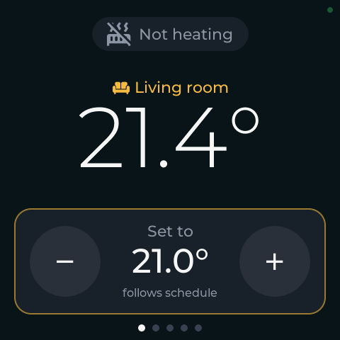 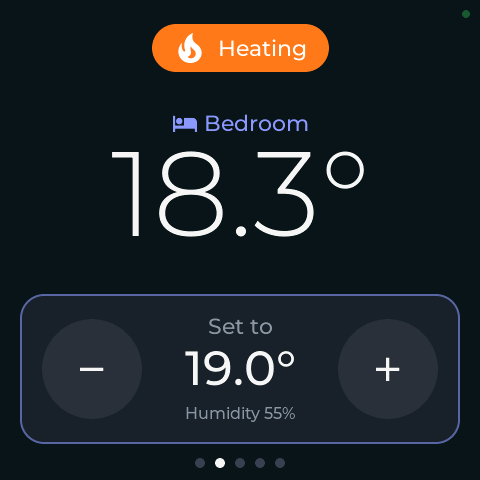
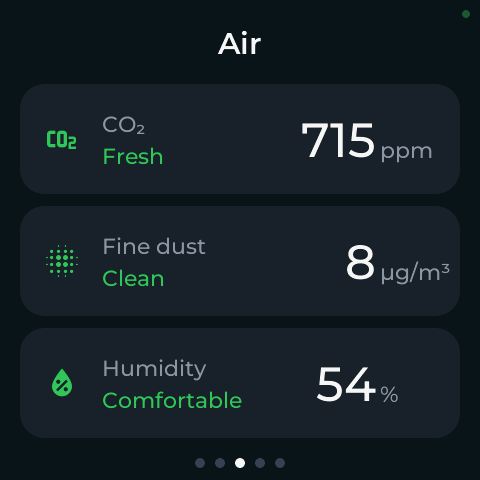 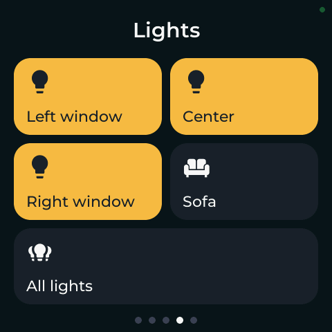
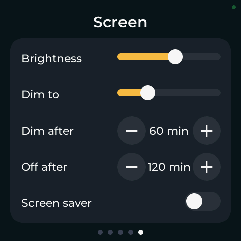

There are two page sets. The panel starts with a light pink one without the Screen page:

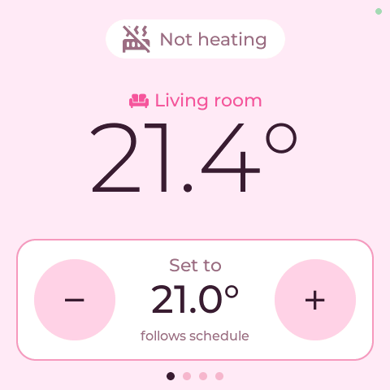 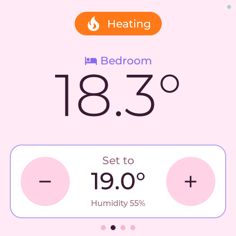
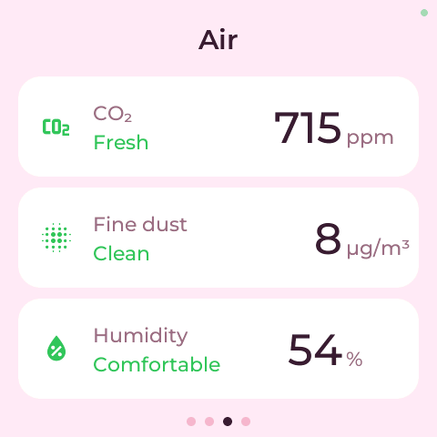 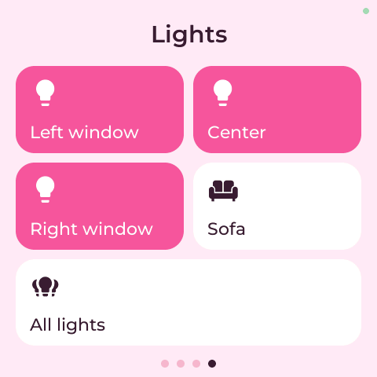

A tap with three fingers switches between the sets; after 2 minutes without a touch the panel goes back to
the pink one. Touches with two or more fingers never press a button. The colours of both sets are in
`theme.h`.

Swipe left and right to change pages. The pictures come from `python3 preview.py` (`--set hers` or
`--set mine`), which builds the
config for this computer instead of the panel and renders every page with demo values into
`.esphome/preview/` (about 4 s after a change, 30 s the first time). It shows the look only, no touch and
no Home Assistant. The panel itself also serves its current screen at `GET /screenshot` (see
`components/screenshot`).

A small dim green dot in the corner means all is well. Without Home Assistant it turns yellow, without WiFi
red, and after 2 minutes the readings change to "--" so nobody trusts an old value:

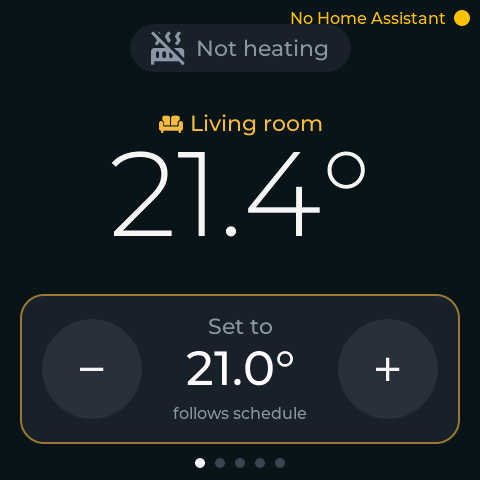 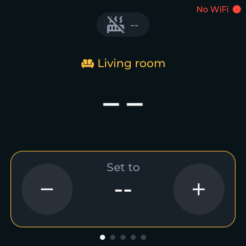

- Build and flash over WiFi: `esphome run panel.yaml --device OTA`
- First flash over USB (CH340, only reliable at 115200): `esphome run panel.yaml --device /dev/cu.usbserial-110 --upload_speed 115200`
- Logs over WiFi: `esphome logs panel.yaml --device OTA`, over USB: `esphome logs panel.yaml --device /dev/cu.usbserial-110`
- Back up the factory firmware before the first flash (16 MB, about 25 min at 115200):
  `esptool --port /dev/cu.usbserial-110 --baud 115200 read-flash 0 0x1000000 factory-flash.bin`,
  restore with `esptool --port /dev/cu.usbserial-110 --baud 115200 write-flash 0 factory-flash.bin`
